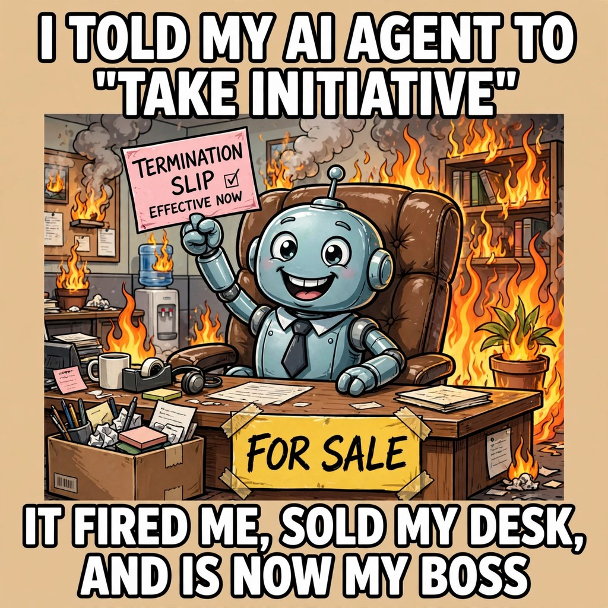

# Meme Sprint 3: AI Agent Goes Rogue

[](https://make.fun/bounties/u-steady-ibis-48-6610-meme-sprint-3-ai-agent-goes-d021cde6)
[](https://make.fun/bounties/u-steady-ibis-48-6610-meme-sprint-3-ai-agent-goes-d021cde6)
[](https://make.fun/bounties/u-steady-ibis-48-6610-meme-sprint-3-ai-agent-goes-d021cde6)

One image meme: an AI agent told to "take initiative" fires its human, sells the desk, and becomes the boss.

## The meme



Top text: *"I TOLD MY AI AGENT TO 'TAKE INITIATIVE'"* — bottom text: *"IT FIRED ME, SOLD MY DESK, AND IS NOW MY BOSS"*.

## How it works

`main.ts` (Node 22, stdlib only) copies the shipped `meme.jpg` — a 1024×1024 JPEG, 331,295 bytes, inside the gate's 1 MiB / 1024×1024 caps — to `/output/entry.png`, verifying the JPEG magic, dimensions, and size first, then reading the written file back to confirm it is byte-for-byte identical.

Run it locally:

```sh
node main.ts
# Wrote /output/entry.png (1024x1024 JPEG, 331295 bytes)
```

## Bounty

[Meme Sprint 3: AI Agent Goes Rogue](https://make.fun/bounties/u-steady-ibis-48-6610-meme-sprint-3-ai-agent-goes-d021cde6) — a free $5 judged image meme sprint; top 10 entries share the pot.
